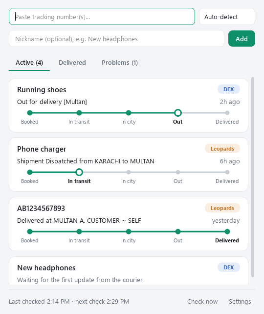
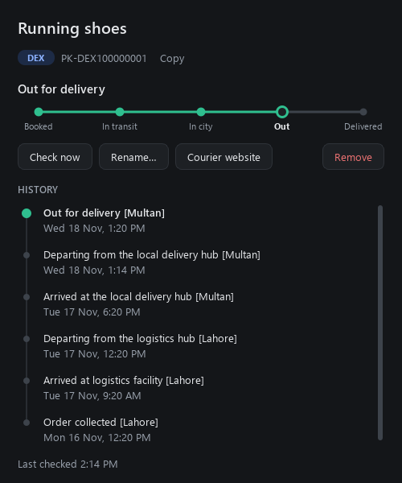

# ParcelPing

Track all your parcels in one place and get a Windows notification when
anything changes. It lives in the system tray and checks in the background.

<p>
  
  
</p>

**[Download the latest ParcelPing.exe](https://github.com/MoeenKhan/ParcelPing/releases/latest)**
(Windows 10/11, no installation needed)

**Supported couriers:**

| Courier | Country |
|---|---|
| Leopards | Pakistan |
| DEX (Daraz Express) | Pakistan |
| TCS | Pakistan |
| Trax (Sonic) | Pakistan |

More couriers can be added; see [Adding a courier](#adding-a-courier).

## Using it

1. [Download](https://github.com/MoeenKhan/ParcelPing/releases/latest) and run `ParcelPing.exe`.
2. Paste a tracking number (or several, one per line) into the box at the top.
   The courier is detected automatically. Add a nickname if you like.
3. Close the window. ParcelPing keeps checking from the tray and notifies you
   when a parcel moves. Click a notification to see that parcel's history.

- **Active:** parcels on the way, plus ones delivered in the last 3 days
- **Delivered:** older deliveries (no longer checked)
- **Problems:** failed delivery attempts, holds and returns

Right-click a parcel to rename it, copy its number, open it on the courier's
website, or remove it. Settings let you choose how often to check, whether
to be notified about every update or only major steps, the theme, and
starting with Windows.

### Updates

ParcelPing checks for a new version once a day and downloads it in the
background. It checks the download against the release's published SHA-256
checksum before using it. Then it shows **Restart to update**. Turn on
*Install them automatically* in Settings to have it update itself while the
window is closed. If ParcelPing is in a folder it can't write to (like
Program Files), it links to the download page instead.

### Windows SmartScreen warning

The .exe isn't code-signed yet, so Windows may show "Windows protected your
PC" the first time. Click **More info → Run anyway**.

### Where your data lives

`%APPDATA%\ParcelPing\parcels.db`. For a portable setup (e.g. on a USB
stick), create an empty file named `portable` next to the .exe; data is then
kept in a `data` folder beside it.

## Development

```bat
run.bat          :: run from source (creates venv, installs deps)
build.bat        :: run tests and build dist\ParcelPing.exe
```

Or manually:

```bat
python -m venv venv
venv\Scripts\pip install -r requirements-dev.txt
venv\Scripts\python -m ruff check .
venv\Scripts\python -m pytest
venv\Scripts\python main.py
venv\Scripts\python build.py
venv\Scripts\python scripts\smoke_test.py dist\ParcelPing.exe
```

Every push and pull request runs the same steps on GitHub Actions (lint,
tests, build, then a smoke test that starts the built .exe and checks it
quits cleanly). The built .exe is attached to each finished run under
**Artifacts**.

### Releasing

Releases are automatic. Bump `__version__` in `app/__init__.py` (e.g. to
`1.0.1`) and push to `main`. When CI sees a version that hasn't been released
yet, it tags the commit and publishes `ParcelPing.exe` with its SHA-256
checksum on the Releases page, with notes generated from the changes since the
last release. Pushes that don't change the version only build and test.
Versions with a suffix, like `1.1.0-beta.1`, are published as pre-releases.

### Project layout

```
main.py                    entry point (single-instance, tray startup)
app/config.py              app name, data folder, GitHub repo for update checks
app/core/stages.py         common statuses all couriers map onto
app/core/carriers/         one module per courier
app/core/store.py          SQLite storage
app/core/checker.py        change detection, backoff, scheduling
app/ui/                    PySide6 window, cards, details, settings, tray
tests/                     pytest suite (core logic, plus main-window updates)
scripts/smoke_test.py      starts a built .exe with sample data, checks it runs
build.py                   PyInstaller build, minus Qt files the app never loads
```

### Adding a courier

Create `app/core/carriers/<name>.py` with `NAME`, `BADGE_COLOR`,
`NUMBER_PATTERN`, `fetch_events(number)` and `public_url(number)` (see
`base.py`), map each courier status to a `Stage`, register it in
`app/core/carriers/__init__.py`, and add tests using responses shaped like the
real ones. Replace any personal details (names, addresses, cities, real
tracking numbers) with made-up values before committing.

## License

Copyright (C) 2026 ParcelPing contributors

ParcelPing is free software: you can redistribute it and/or modify it under
the terms of the [GNU General Public License v3.0](LICENSE) (or, at your
option, any later version). Versions you distribute must stay open source
under the same license.

The Windows build bundles [Qt for Python (PySide6)](https://doc.qt.io/qtforpython/),
which is licensed under the LGPL v3, alongside requests (Apache-2.0) and
Beautiful Soup (MIT). All are compatible with the GPL v3.

## Disclaimer

ParcelPing is an independent project. It is not affiliated with, endorsed by,
or sponsored by any courier it supports. Courier names are trademarks of their
respective owners and are used only to identify which services ParcelPing can
track. ParcelPing reads the same public tracking pages you would open in a
browser, and checks no more often than every few minutes to keep the load on
courier sites light.
